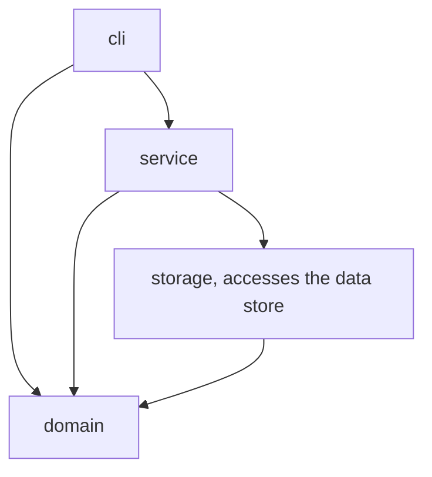
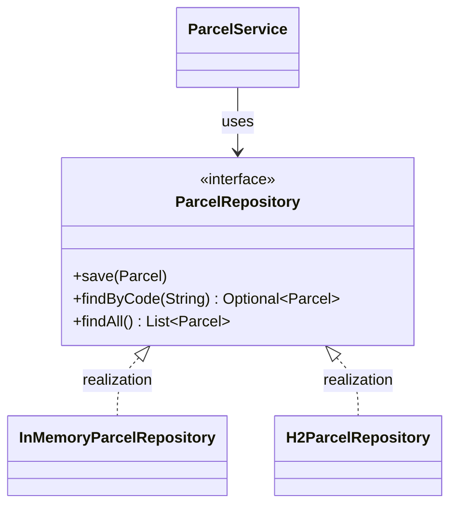
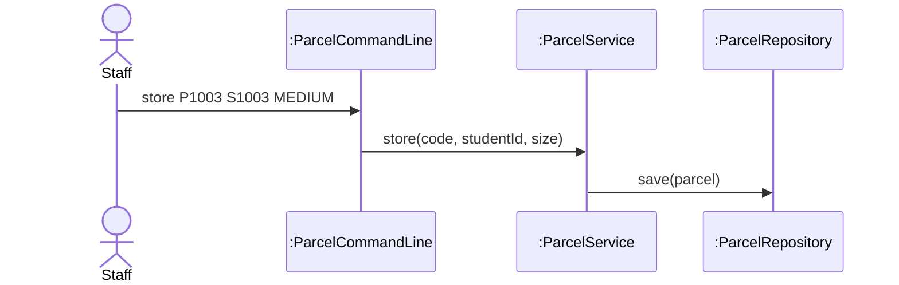

# Lab Report, Designing the Data Management Layer with H2

Repository URL:

## Tools

| Item | Version or name |
| --- | --- |
| JDK | OpenJDK 25.0.5|
| Maven | Apache Maven 3.10.0|
| IDE | Visual Studio Code|
| AI tool and exact model, if you used one |Gemini |

## Part 0. From a store in memory to H2

Commit of the starter, before any change:

0.3 Your prediction for `staff`, written before the second run:
Both parcels will be gone, and all three lockers will be free.

Output of the second run, for `staff` and `quit`:
Free lockers: 3

```text

```

State in one sentence where you think the parcels of the first run were kept.
The parcels of the first run were kept in the memory (RAM) of the running program.

0.5 The line of Main that you would change to keep the parcels somewhere else:

```java

ParcelRepository repository = new InMemoryParcelRepository();

```

0.6 Commit of the switch to H2: 349dde2 

0.7 Output of `SELECT * FROM PARCEL;` after you stored two parcels:

```text
CODE | STUDENT_ID | PARCEL_SIZE | STATUS | LOCKER_NUMBER
P1001 | S1001 | SMALL | STORED | 1
P1002 | S1002 | LARGE | STORED | 3
```

0.8 Explain why ParcelPoint could not start while the H2 Shell was open, and identify the class that wrote the message `Cannot create the PARCEL table`.
ParcelPoint could not start because the embedded H2 database file was locked by the running H2 Shell, making it inaccessible to other processes. The class that wrote the first line of the error is H2ParcelRepository.

0.9 Explain why `staff` shows no parcel while `find` shows each one, and why all three lockers look free.
`staff` shows no parcels because the `findAll` method in `H2ParcelRepository` has not been implemented yet to retrieve data from the database, whereas `find` uses `findByCode` which is already implemented.

0.11 Your findAll method:

```java
public List<Parcel> findAll() {
    String sql = "SELECT * FROM PARCEL ORDER BY CODE";
    List<Parcel> parcels = new ArrayList<>();
    try (Connection connection = connect();
         PreparedStatement statement = connection.prepareStatement(sql);
         ResultSet row = statement.executeQuery()) {
        while (row.next()) {
            parcels.add(toParcel(row));
        }
    } catch (SQLException e) {
        throw new IllegalStateException("Cannot read the parcels", e);
    }
    return parcels;
}
```

Commit that adds findAll: df517b9

0.12 Output of `SELECT * FROM PARCEL;` after the pickup:

```text
sql> SELECT * FROM PARCEL;
CODE  | STUDENT_ID | PARCEL_SIZE | STATUS    | LOCKER_NUMBER
P1001 | S1001      | SMALL       | PICKED_UP | null
P1002 | S1002      | LARGE       | STORED    | 3
(2 rows, 34 ms)
```

0.13 Optional. Describe what `find P9999'OR'1'='1` showed while the SQL was joined from strings, and what it showed after you put the placeholder back.
-

## Part A. Model the design

A1 Complete the flowchart with one node for each package and one arrow for each dependency, from the package that uses to the package that is used. Mark the package that accesses the data store.



State whether cli depends on storage, and explain why.
 No, cli does not depend directly on storage. Because the Command Line Interface layer interacts only with the service layer to handle user commands.

A2 Complete the class diagram of the data management layer with ParcelService, the interface ParcelRepository with its three operations, and the two classes that implement it.



A3 Draw a sequence diagram for the command `store P1003 S1003 MEDIUM`, from the staff member to the repository. Show each message as an operation of the class that receives it.



Explain why the last lifeline is the interface ParcelRepository rather than H2ParcelRepository.
 Because `ParcelService` depends on the abstract `ParcelRepository` interface for loose coupling

## Part B. Design questions

1. Identify the files that you changed to move from the store in memory to H2, and explain why no other class had to change. Use the terms of this course.
  Changed Main.java and created H2ParcelRepository.java. No other classes changed due to polymorphism and programming to the ParcelRepository interface.

2. The PARCEL table stores the size of a parcel as SMALL, MEDIUM or LARGE rather than as 1, 2 or 3. Identify the type of connascence between ParcelSize and the table in each case, and explain which one is weaker.
 Strings use connascence of name, while numbers use connascence of value. Connascence of value is weaker and more robust against naming changes.

3. Project Phase 2 asks for a data store that needs no separate server. Explain why an embedded database such as H2 meets this rule, and describe the limit of an embedded database that Step 0.8 showed.
  H2 runs within the application process without a separate server. The limit shown in Step 0.8 is that it locks the database file, preventing concurrent access from multiple processes.

4. State the data store that you would choose for your Project Phase 2 team, files or an embedded database, the requirement that drives the choice, and the package that will access it.
  Choose an embedded database driven by the need for structured queries and persistence without server overhead, accessed exclusively by the storage package.

## AI usage declaration

| AI tool and exact model | Date | Purpose | Files or answers it produced or changed | How you checked its output |
| --- | --- | --- | --- | --- |
| Gemini | 12/11/69 | Assisting with lab report design questions and code implementation| LAB_REPORT.md and H2ParcelRepository.java| Tested the code via Maven build, program execution, and H2 shell verification|
